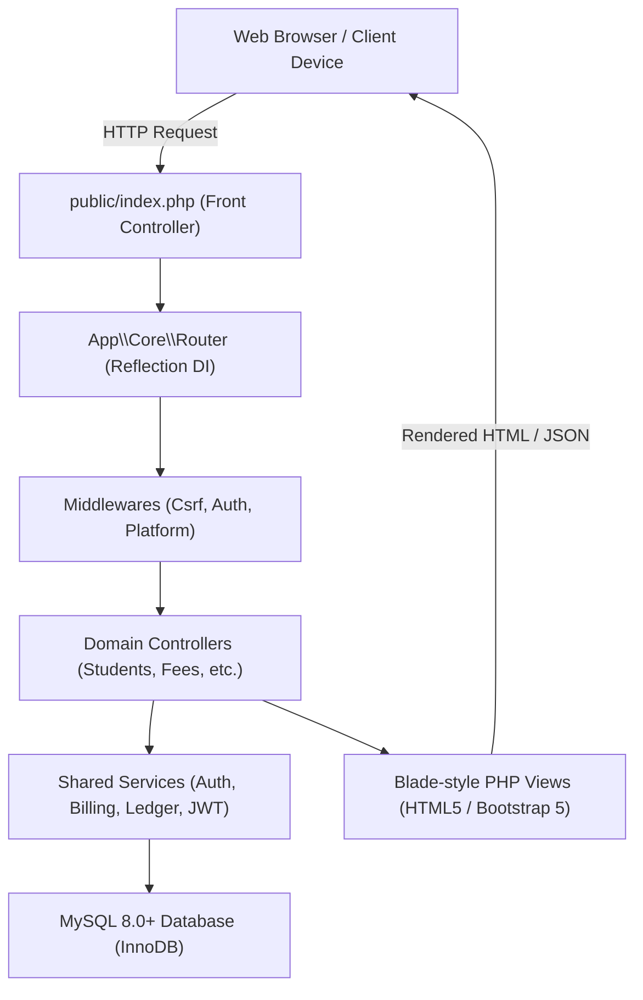

# TuitionPro ERP — Tuition Institute Management System

[](https://www.php.net/)
[](https://www.mysql.com/)
[]()
[-success.svg)]()
[]()

---

## 1. Project Introduction

**TuitionPro ERP** is a modern, enterprise-grade Tuition Institute Management System architected for private educational institutes, tutoring academies, and coaching centers. Built using pure PHP 8.2+, MySQL 8.0+ (InnoDB), Bootstrap 5, and vanilla JavaScript ES6+, TuitionPro ERP consolidates all administrative, academic, financial, and student-parent communication workflows into a single cohesive, high-performance platform.

### What Problem It Solves
Private tuition institutes typically struggle with fragmented operations:
- Paper-based student registrations and lost admission documents.
- Time-consuming roll calls and chaotic attendance recording.
- Revenue leakages from uncollected tuition fees and unmonitored installment defaulters.
- Complicated, dispute-prone teacher revenue-share and session-based payroll calculations.
- Disconnected bookkeeping that fails to follow standard double-entry accounting principles.
- Lack of transparency for parents regarding attendance turnout and examination rankings.

### Target Users
- **Institute Owners & Managing Directors:** Executive analytics, financial ledger oversight, and profit/loss control.
- **Academic Coordinators & Branch Managers:** Course, subject, and class batch scheduling.
- **Office Staff & Receptionists:** Student admission wizards, barcode QR attendance check-in, fee collection, and instant receipt generation.
- **Teachers & Lecturers:** Class session rosters, examination marks entry, study material distribution, and homework tasks.
- **Students:** Dedicated portal for timetables, attendance turnout, fee payment status, examination results, and downloadable class notes.
- **Parents & Guardians:** Multi-child monitoring portal showing real-time attendance rates, outstanding balances, fee receipts, and batch rankings.

### Main Business Value & Commercial Delivery Model
TuitionPro ERP is architected as a **single-installation, developer-controlled, reusable enterprise product**. 
- Each client institute (e.g., Apex, Iskole, Pasala) is deployed as an **independent installation** with its own dedicated MySQL database, private file storage, and centralized institute configuration.
- Runtime multi-tenancy, public self-registration, and shared databases have been deliberately eliminated to maximize data security, customer privacy, and customization flexibility.

---

## 2. Main Features

### 2.1 Institute & Branch Management
- **Single-Installation Profile:** Centralized institute profile configured via `config/institute.php` and `.env` (name, address, hotline, email, currency symbol, and timezone).
- **Multi-Branch Operations:** Manage multiple physical branch locations (e.g., Main Campus, City Center) with branch-specific staff assignments, batch locations, and filtered financial reporting.

### 2.2 Student Management & Admissions
- **Comprehensive Admission Wizard:** Multi-step registration capturing student biodata, emergency contacts, guardian linking, and initial batch enrollments in a single atomic database transaction.
- **Search & Filtering:** Instant live filter by branch, grade, enrolled batch, and admission number with pagination.
- **Student Profile:** Complete 360° overview displaying enrollment history, monthly fee invoice ledger, attendance statistics, and exam reports.
- **Printable Student ID Card:** Dynamic, print-ready ID cards featuring institute branding, student photograph, admission number, and an embedded student QR barcode at `/students/{id}/id-card`.
- **Directory Export:** One-click CSV export of student contact lists.

### 2.3 Parent & Guardian Management
- **Multi-Child Guardian Linking:** Flexible relationship mapping through the `student_guardians` join table supporting primary and emergency contacts.
- **Multi-Child Switcher:** Parents with multiple enrolled children can toggle between their children seamlessly within the Parent Portal.

### 2.4 Teacher Management & Payroll
- **Teacher Directory:** Profiles, assigned academic subjects, assigned class batches, contact details, and employment information.
- **5 Compensation Contract Models:**
  1. *Fixed Monthly:* Fixed salaried compensation.
  2. *Per-Session:* Fixed payment per completed teaching session.
  3. *Per-Student:* Variable rate multiplied by active enrolled students.
  4. *Revenue % Share:* Direct revenue sharing from collected monthly tuition fees.
  5. *Custom:* Custom hourly and contracted compensation rates.
- **Payroll Calculation Engine:** Automated period-based compensation calculator computing gross earnings, deductions, net payable vouchers, and payment disbursals at `/teacher-payments`.

### 2.5 Academic Management, Batches & Scheduling
- **Courses & Subjects:** Academic catalog managing subjects, syllabus codes, and grade levels.
- **Class Batches & Quotas:** Batch setup with seat capacity limits, monthly fee schedules, and active student enrollment rosters.
- **Timetable & Conflict Detection:** Weekly class schedule builder detecting classroom and teacher scheduling overlaps.
- **Automated Session Generator:** Generates concrete calendar class sessions from weekly recurring schedules.

### 2.6 Attendance Management & QR Scanner
- **Manual Attendance Sheet:** Batch-wise attendance marking with `present`, `late`, `absent`, and `excused` statuses.
- **Interactive Browser QR Scanner:** Real-time web camera scanner at `/attendance/qr-scanner` that reads student ID QR codes and records check-ins instantaneously.
- **Attendance History & Audit Corrections:** Searchable attendance logs with authorized manual correction workflows.

### 2.7 Fees, Invoicing & Receipts
- **Itemized Fee Invoicing:** Monthly tuition billing, admission fees, and examination fees with custom discounts and line items.
- **Partial Payments & Allocations:** Flexible partial payment allocations that automatically update outstanding invoice balances using strict `DECIMAL(12,2)` precision.
- **Printable Receipts:** Branded payment receipts featuring institute logo, tax/fee itemization, student details, and payment method details at `/fees/receipt/{id}`.
- **Outstanding Fee Defaulters:** Dedicated receivables tracking at `/fees/outstanding` detailing overdue balances and guardian contact details.
- **Payment Refunds:** Controlled, auditable refund processing at `/fees/refund` with automatic journal adjustments.

### 2.8 Examinations, Grading & Merit Rankings
- **Exam Scheduling:** Define evaluation titles, subjects, batches, dates, and maximum marks.
- **Marks Entry:** Fast tabular marks entry sheet with absent student toggles.
- **Automatic Letter Grading:** Configurable grading criteria (A, B, C, S, F).
- **Merit Class Rankings:** Automated batch rank computation (e.g. Rank #1, Rank #2) displayed on student and parent report cards.

### 2.9 Learning Materials & Assignments
- **Learning Materials Repository:** Teachers upload lecture notes, presentation slides, PDF guides, and external links filtered by class batch at `/academic/materials`.
- **Assignments & Coursework:** Post homework assignments, submission deadlines, maximum score guidelines, and task briefs at `/academic/assignments`.
- **Student Download Access:** Students and parents can access and download study materials and homework briefs directly from their portals.

### 2.10 Operating Expenses & Cash/Bank Management
- **Expense Voucher Management:** Record operational overheads (rent, utilities, stationery) with category tagging, voucher numbers (`EXP-XXXX`), and receipt attachments at `/expenses`.
- **Cash & Bank Balances:** Monitor live balances for institute cash drawers and bank accounts at `/accounting/cash-bank`.

### 2.11 Double-Entry General Ledger Accounting
- **Chart of Accounts:** Standard assets, liabilities, equity, revenue, and expense accounts.
- **Automated Journal Posting:** Student fee collections, refunds, teacher payments, and operational expenses automatically generate balanced journal entries.
- **Debit == Credit Invariant:** Strict server-side validation ensuring that unbalanced journals cannot be posted.
- **Trial Balance:** Live ledger verification at `/expenses/trial-balance` confirming total debits strictly equal total credits.
- **Profit & Loss Statement:** Real-time Income Statement at `/accounting/profit-loss` summarizing gross fee revenue, direct academic expenses, overheads, and net operating margin.

### 2.12 Communication & Notice Board
- **Broadcast Announcements:** Broadcast notices targeted to `all`, `students`, or `parents` at `/communication/announcements`.
- **Notification Inbox:** User notification feed tracking unread operational alerts at `/notifications`.

### 2.13 Student & Parent Portals
- **Student Portal (`/portal/student`):** Personal dashboard displaying timetable schedules, attendance turnout %, published examination marks and ranks, fee invoices, class study notes, and homework assignments.
- **Parent Portal (`/portal/parent`):** Multi-child switcher, attendance turnout %, total outstanding dues, exam results, and child study materials.

### 2.14 Executive Dashboard & Business Intelligence
- **Role-Based Dashboards:** Customized KPI summaries for Super Admins, Institute Directors, Teachers, Students, and Parents.
- **7 Reporting Suites (`/reports/*`):** Comprehensive analytical reports covering Monthly Attendance, Fee Collections, Aged Defaulters, Teacher Payments, Operational Expenses, and Student Performance.

### 2.15 Planned & Incomplete Features (Transparent Disclosure)
In accordance with our strict verification audit, the following non-blocking capabilities are identified as planned for future iterations:
- *Online Student Assignment Submissions:* Students currently download assignment briefs; online file upload submission by students is not yet implemented.
- *Automated SMS/Email Dispatch:* External SMS gateway is configured with `SMS_DRIVER=none`; real-time absence SMS and automated fee reminder cron dispatchers require third-party gateway connection.
- *Student Document Archival:* Attaching physical identity documents (e.g., birth certificates, NIC scans) to student profiles.
- *Multi-Stage Expense Approval Queue:* Expenses are currently recorded directly as confirmed vouchers.
- *Formal Balance Sheet View:* Trial Balance and Profit & Loss Statement are fully functional; a full formal Balance Sheet report view is planned.

---

## 3. User Roles and Permissions

TuitionPro ERP enforces a strict 4-tier Role-Based Access Control (RBAC) hierarchy:

```
Developer / System Super Admin  (super_admin, support_admin)
      │
      ▼
Institute Director / Owner / Manager  (institute_owner, institute_admin)
      │
      ▼
Front Desk / Operations Staff  (receptionist, accountant, teacher, branch_manager)
      │
      ▼
End Users / Stakeholders  (student, parent)
```

| User Role | Access Scope | Permitted Capabilities | Restrictions |
|---|---|---|---|
| **System Super Admin** | `/platform/*` | Server runtime health, initial Institute Admin setup, emergency password reset with JWT token revocation. | Does not participate in daily institute billing. |
| **Institute Owner / Director** | Full Application | Full executive authority, financial ledgers, fee pricing, teacher compensation rules, staff user provisioning. | Cannot create Super Admins or access other server installations. |
| **Institute Admin / Manager** | Full Application | Academic operations, batch quotas, class sessions, marks publishing, general settings. | Cannot create Super Admins. |
| **Receptionist / Front Desk** | `/students`, `/attendance`, `/fees` | Student admissions, guardian linking, batch enrollment, attendance taking, fee collection, receipt printing. | Blocked from institute settings, accounting ledger, and teacher payroll. |
| **Teacher / Lecturer** | `/timetable`, `/attendance`, `/examinations`, `/academic/*` | View assigned class schedules, take session attendance, enter exam marks, upload study notes, create assignments. | Blocked from financial records, fee collections, and staff management. |
| **Student** | `/portal/student` | View personal timetable, attendance percentage, examination scores, fee statements, study notes, homework briefs. | Strictly restricted to personal records; cannot view other students. |
| **Parent / Guardian** | `/portal/parent` | Multi-child switcher, monitor linked children's attendance, fee dues, exam report cards, and homework. | Strictly restricted to explicitly linked children via `student_guardians`. |

---

## 4. System Architecture

TuitionPro ERP is architected around a clean, lightweight, decoupled Modular MVC design pattern:



### Request Lifecycle
1. **Front Controller (`public/index.php`):** Initializes the application container, loads environment variables (`.env`), registers autoloader paths, and handles session/cookie headers.
2. **Router with Reflection DI (`App\Core\Router`):** Matches incoming HTTP methods and URIs. Uses PHP `ReflectionMethod` to inject typed arguments automatically, supporting both clean RESTful URL parameters (`/students/{id}`, `/teachers/{id}`) and query string fallbacks (`?id=X`).
3. **Middleware Pipeline:**
   - `CsrfMiddleware`: Enforces anti-CSRF token verification on all state-changing requests (`POST`).
   - `AuthMiddleware`: Validates JWT access tokens from HttpOnly cookies and transparently triggers refresh-token rotation when expired.
   - `PlatformAdminMiddleware`: Isolates developer system administration routes (`/platform/*`).
4. **Service Layer:** Encapsulates business logic away from controllers:
   - `JwtService`: HMAC-SHA256 token issuance and cryptographic verification.
   - `BillingService`: Invoice calculations, partial payment allocation, and balance settlement.
   - `AccountingService`: Double-entry journal posting, Trial Balance, and Profit & Loss statement.
   - `TeacherPaymentService`: 5-model compensation calculation engine.
   - `RateLimiter`: Brute-force login defense.
5. **Data Layer (`App\Core\Database`):** Singleton PDO wrapper enforcing 100% prepared statements with parameterized inputs.

---

## 5. Technology Stack

- **Backend Language:** PHP 8.2+ (Pure vanilla, zero third-party framework overhead)
- **Database Engine:** MySQL 8.0+ (InnoDB, strict foreign key constraints, `utf8mb4_unicode_ci`)
- **Database Abstraction:** PHP Data Objects (PDO) with prepared statements
- **Authentication:** Pure PHP RFC 7519 JSON Web Tokens (HS256) with refresh token rotation
- **Frontend Framework:** Bootstrap 5.3.2, Bootstrap Icons 1.11
- **UI Styling:** Custom SaaS enterprise theme (`#6C4EE3`, `#5638C4`, `#FF7A59`, `#F7F6FB`, Inter typography)
- **Client Scripting:** Modern Vanilla JavaScript (ES6+, Fetch API, HTML5 Camera Scanner)
- **Data Visualizations:** Chart.js 4.4
- **Web Server:** Apache 2.4+ (XAMPP / Linux VPS) or PHP Built-in Server

---

## 6. Project Folder Structure

```
TuitionPro ERP/
├── app/
│   ├── Controllers/          # Domain Controllers (Academic, Auth, Fees, Reports, etc.)
│   ├── Core/                 # Framework Core (Router, Controller, Database, Request, Response)
│   ├── Helpers/              # Global helpers (url(), e(), institute_name(), csrf_token())
│   ├── Middleware/           # Request filters (AuthMiddleware, CsrfMiddleware, PlatformAdmin)
│   ├── Models/               # Active Record Database Entities (Student, Invoice, Batch, etc.)
│   └── Services/             # Business Logic (JwtService, BillingService, AccountingService)
├── config/
│   └── institute.php         # Centralized Institute Profile & Configuration
├── database/
│   ├── migrations/           # Versioned DDL Schema Migrations (001_initial, 002_jwt_auth)
│   └── seeds/                # Demo Dataset Seeders (001_seed_demo_data.php)
├── public/
│   ├── assets/               # Static assets (CSS, Vanilla JS, SVG logos)
│   ├── index.php             # Front Controller & Application Entry Point
│   └── .htaccess             # Apache URL rewriting & security headers
├── resources/
│   └── views/                # Modular Blade-style Views (Academic, Fees, Portals, Layouts)
├── routes/
│   └── web.php               # Application Route Definitions
├── storage/
│   ├── backups/              # Generated Database SQL Snapshot Archives
│   ├── cache/                # Application Caches
│   ├── logs/                 # Daily Application & Error Logs
│   └── uploads/              # Uploaded Files (Materials, Assignments, ID Photos)
├── tests/                    # Automated Verification & Smoke Suites
│   ├── test_jwt_auth.php     # 16 JWT Security Assertions
│   ├── test_backend_core.php # 16 Core Backend & Ledger Assertions
│   ├── test_e2e_workflows.php# 28 Student Lifecycle & Billing Assertions
│   └── test_http_routes.php  # 59 Live Route Smoke Test Assertions
├── .env.example              # Sanitized Environment Configuration Template
├── .gitignore                # Git Exclusions (Protects .env, logs, and backups)
└── README.md                 # Master Technical Documentation
```

---

## 7. Database Documentation

- **Database Name:** `tuitionpro`
- **Engine:** InnoDB with strict referential integrity (`ON DELETE CASCADE` / `ON DELETE SET NULL`)
- **Monetary Precision:** All currency fields strictly utilize `DECIMAL(12,2)`. Floating-point arithmetic is prohibited.

### Main Table Domains
1. **Tenancy & Institute:** `tenants`, `branches`, `system_settings`
2. **Security & Authentication:** `users`, `roles`, `permissions`, `role_permissions`, `refresh_tokens`, `login_attempts`
3. **Academics:** `academic_years`, `subjects`, `batches`, `enrollments`
4. **Students & Guardians:** `students`, `guardians`, `student_guardians`
5. **Teachers & Staff:** `teachers`, `teacher_payment_rules`, `teacher_payments`
6. **Timetable & Attendance:** `schedules`, `class_sessions`, `attendance_records`
7. **Billing & Accounting:** `invoices`, `invoice_items`, `payments`, `payment_allocations`, `expenses`, `chart_of_accounts`, `financial_accounts`, `journal_entries`, `journal_lines`
8. **Examinations & Learning:** `examinations`, `exam_marks`, `learning_materials`, `assignments`
9. **Communication & Audits:** `announcements`, `notifications`, `audit_logs`

---

## 8. Installation Guide (XAMPP / Localhost)

Follow this step-by-step walkthrough to get TuitionPro ERP up and running on a local development machine:

### Prerequisites
- [XAMPP for Windows](https://www.apachefriends.org/) with **PHP 8.2+** and **MySQL 8.0+**
- Git installed on your workstation

### Step 1: Clone the Repository
Clone the repository into your local directory:
```bash
cd "C:\xampp\htdocs"
git clone https://github.com/VishwaSashintha/TUITION-ERP.git tuitionpro
```

### Step 2: Configure the Environment File
Copy the configuration template to create your local `.env`:
```bash
cd tuitionpro
copy .env.example .env
```
Ensure your database credentials in `.env` match your local MySQL server:
```ini
APP_NAME="TuitionPro ERP"
APP_ENV=local
APP_DEBUG=true
APP_URL=http://localhost:8080

DB_HOST=127.0.0.1
DB_PORT=3306
DB_DATABASE=tuitionpro
DB_USERNAME=root
DB_PASSWORD=
```

### Step 3: Create & Import the Database
1. Start **Apache** and **MySQL** via the XAMPP Control Panel.
2. Open your terminal or MySQL command line and create the database:
   ```sql
   CREATE DATABASE tuitionpro CHARACTER SET utf8mb4 COLLATE utf8mb4_unicode_ci;
   ```
3. Import the core schema and authentication migrations:
   ```bash
   mysql -u root tuitionpro < database/migrations/001_initial_schema.sql
   mysql -u root tuitionpro < database/migrations/002_jwt_auth_schema.sql
   ```
4. Run the demo seeder to populate sample branches, batches, students, and demo accounts:
   ```bash
   php database/seeds/001_seed_demo_data.php
   ```

### Step 4: Start the Application Server
Run the application using PHP's built-in development server (or access through Apache VirtualHost):
```bash
php -S localhost:8080 -t public
```

### Step 5: Log In with Demo Accounts
Navigate to **`http://localhost:8080/login`** in your web browser. All sample accounts use password **`Password@123`**:

| Account Role | Email Address | Access URL |
|---|---|---|
| **System Super Admin** | `superadmin@tuitionpro.lk` | `/platform/dashboard` |
| **Institute Director / Owner** | `apex.owner@tuitionpro.lk` | `/dashboard` |
| **Institute Admin / Manager** | `apex.admin@tuitionpro.lk` | `/dashboard` |
| **Receptionist / Front Desk** | `apex.reception@tuitionpro.lk` | `/students` |
| **Teacher / Lecturer** | `apex.fernando@tuitionpro.lk` | `/timetable` |
| **Student** | `apex.student1@tuitionpro.lk` | `/portal/student` |
| **Parent / Guardian** | `apex.parent1@tuitionpro.lk` | `/portal/parent` |

---

## 9. Configuration

- **Centralized Institute Profile (`config/institute.php`):**
  Defines institute name, code, contact telephone, address, currency symbol, and logo asset paths.
- **JWT Security Settings:**
  - `JWT_SECRET`: 64-character cryptographic HMAC secret.
  - `JWT_ACCESS_TTL=900`: Access token lifetime in seconds (15 minutes).
  - `JWT_REFRESH_TTL=604800`: Refresh token lifetime in seconds (7 days).
- **Session & Cookie Security:**
  - Cookies delivered with `HttpOnly=true` and `SameSite=Lax`.
  - For local development over HTTP, `SESSION_SECURE_COOKIE=false`. In production over HTTPS, set `SESSION_SECURE_COOKIE=true`.

---

## 10. Security & Threat Mitigation

- **Cryptographic JWT Engine:** Pure PHP HMAC-SHA256 (`HS256`). Rejects unsigned tokens (`alg: none`) and invalid signatures.
- **Refresh Token Rotation & Replay Defense:** Rotating refresh tokens on every renewal. Replay of an already-revoked token revokes all user sessions instantly.
- **Brute-Force Rate Limiting:** Enforces 5 failed attempts per 5 minutes per IP/username.
- **SQL Injection Defense:** 100% of queries use PDO prepared statements with parameter binding.
- **Cross-Site Scripting (XSS) Defense:** All view outputs escaped via `e()` helper (`htmlspecialchars(..., ENT_QUOTES, 'UTF-8')`).
- **CSRF Defense:** Session-bound anti-CSRF token verification on all POST requests.
- **File Upload Protection:** MIME checking, extension allowlisting, and 10MB file size limits for study materials and receipts.
- **Audit Logging:** System events, financial transactions, and attendance adjustments logged to `audit_logs`.

---

## 11. Testing & Automated Verification

TuitionPro ERP includes 4 automated verification test suites:

```bash
# Execute JWT Authentication & Security Suite
php tests/test_jwt_auth.php

# Execute Core Backend & Multi-Tenant Isolation Suite
php tests/test_backend_core.php

# Execute End-to-End Workflow Verification Suite
php tests/test_e2e_workflows.php

# Execute Full HTTP Route Smoke Verification Suite
php tests/test_http_routes.php
```

### Verified Test Results
- **JWT Security Suite:** 16 / 16 PASS (100%)
- **Backend Core Suite:** 16 / 16 PASS (100%)
- **E2E Workflows Suite:** 28 / 28 PASS (100%)
- **HTTP Routes Smoke Suite:** 59 / 59 PASS (100%)
- **PHP Syntax Validation (`php -l`):** 142 / 142 CLEAN (0 Errors)
- **Total Assertions:** **119 / 119 Passed (100% Success Rate)**

---

## 12. User Interface & Branding

- **Design System Palette:**
  - Primary Purple: `#6C4EE3`
  - Dark Primary: `#5638C4`
  - Accent Coral: `#FF7A59`
  - Soft Canvas Background: `#F7F6FB`
  - Typography: Clean, readable `Inter` font family.
- **Vector SVG Assets:**
  - Full Color Logo: `public/assets/images/logo.svg`
  - White on Dark Logo: `public/assets/images/logo-white.svg`
  - Square Icon Mark: `public/assets/images/logo-mark.svg`

---

## 13. Current Development Status

TuitionPro ERP is at **Version 1.0.0 Release Candidate**. The core tuition management workflows, attendance tracking, fee invoicing, double-entry accounting ledger, student/parent portals, and JWT security layer are fully implemented and verified with 100% passing automated test assertions.

---

## 14. Future Improvements (Roadmap)

1. **Student Online Homework Submissions:** Implement online student file upload handlers and teacher feedback comments.
2. **Live SMS Gateway Integration:** Connect a live telecommunications SMS API (Dialog, Mobitel, Twilio) for instant parent arrival/absence notifications and automated overdue fee reminders.
3. **Student Profile Document Management:** Add document attachment dropzone in student profiles for birth certificates and national identity card scans.
4. **Multi-Stage Expense Approval Queue:** Add pending $\rightarrow$ approved $\rightarrow$ rejected workflow for operational expenditures.
5. **Formal Balance Sheet View:** Add full Balance Sheet statement report view to complement the existing Trial Balance and Profit & Loss reports.
6. **Automated Uploads ZIP Backup:** Bundle physical files in `storage/uploads` into a ZIP archive alongside the existing MySQL SQL dump.

---

## 15. License & Terms of Use

TuitionPro ERP is **proprietary commercial software**. All rights are reserved by the author. Unauthorized copying, distribution, modification, public hosting, or commercial deployment without prior written authorization is strictly prohibited.
