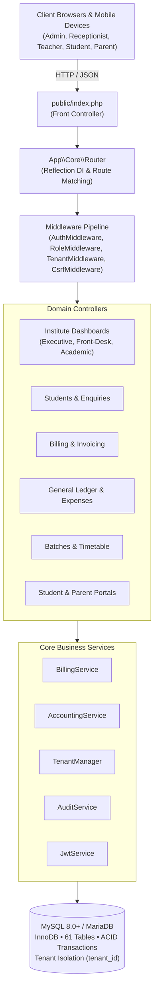

# TuitionPro ERP — Education Management & Enterprise Resource Planning System

[](https://php.net)
[](https://mysql.com)
[](https://github.com/VishwaSashintha/TUITION-ERP)
[](https://github.com/VishwaSashintha/TUITION-ERP)
[-success)](https://github.com/VishwaSashintha/TUITION-ERP)
[](https://github.com/VishwaSashintha/TUITION-ERP)

TuitionPro ERP is a commercial-grade, multi-tenant and standalone Education Management and Enterprise Resource Planning platform engineered for tuition institutes, private schools, tuition centres, and large multi-branch educational organizations.

Built in pure PHP 8.2+ and MySQL/MariaDB with zero framework bloat, TuitionPro delivers enterprise-scale performance, strict double-entry financial integrity, comprehensive 14-role role-based access control (RBAC), fine-grained server-side data isolation, and user-specific dashboard experiences.

---

## 1. Core Architecture & Dual Deployment Modes

TuitionPro is **ONE unified, reusable software product** that seamlessly supports two deployment models on the exact same codebase:

### 1.1 Mode A: Standalone Installation (Single Institute)
- One dedicated installation serving one customer institute (e.g. Apex Higher Education Institute, Iskole, Pasala).
- Dedicated local database and `.env` institute profile (`INSTITUTE_NAME`, `INSTITUTE_CODE`, `INSTITUTE_CURRENCY`, `INSTITUTE_LOGO`).
- Local branch campuses managed under a unified single-institute tenancy.

### 1.2 Mode B: Multi-Institute Platform (Education Groups & SaaS)
- One centrally managed installation serving multiple independent institutes, regional branches, and education groups.
- Centrally administered via the Platform Super Admin Dashboard (`/platform/dashboard`).
- Dynamic tenant provisioning, subscription tier limits (student and staff caps), and automated institute onboarding.
- Strict database-level tenant scoping (`tenant_id`) ensuring 100% multi-tenant data isolation.



---

## 2. Official Visual Identity & Design System

TuitionPro ERP adheres to a visual design language engineered for readability, fast operations, and visual clarity:

### 2.1 The Approved 6-Color Palette
| Purpose | Color Name | Hex Code | Visual Application |
|---|---|:---:|---|
| **Primary Dark** | Black | `#0C0C0C` | High-contrast typography, headings, dark navigation accents |
| **Primary Brand** | Green | `#4BA95F` | Primary action buttons, positive states, payment collections, receipts |
| **Secondary** | Light Blue | `#77DDFA` | Informational cards, timetable sessions, student metric indicators |
| **Accent** | Orange | `#FEA339` | Warnings, pending fee notices, upcoming session indicators |
| **Accent** | Purple | `#9985FB` | Batch cohorts, academic subjects, secondary action accents |
| **Accent** | Coral | `#FF908D` | Urgent alerts, overdue balances, expense tags, error badges |

### 2.2 Typography Hierarchy
- **Roboto:** Used for all base interface text, navigation links, form controls, table rows, and descriptions.
- **Poppins SemiBold 700:** Used exclusively for high-impact numeric values, KPI statistic counters, financial balances, and currency figures.

---

## 3. Comprehensive Feature Matrix

### 3.1 Prospective Student Enquiries & Admissions Lifecycle
- **Lead Capture:** Record prospective student inquiries with contact details, grade, course interest, and lead source (Walk-in, Phone, Social Media, Website, Referral) (`/students/enquiries`).
- **Interaction Timeline:** Log follow-up interactions with contact channel (Call, WhatsApp, In-Person Visit, Email), outcome notes, and next follow-up dates.
- **One-Click Admission Conversion:** Instantly convert an enquiry into an active student record with automated admission number generation.
- **Receptionist Follow-up Alerts:** Live counter of follow-ups due today rendered on the Front-Desk Dashboard.

### 3.2 Student Profiles, Guardians & Digital QR ID Cards
- **Student Onboarding:** Full registration workflow with unique admission numbers (`APX-YYYY-XXXX`).
- **Directory & Filters:** Searchable directory with real-time filters by branch, grade, and active/inactive status (`/students`).
- **Guardian Linking:** Multi-guardian relationship management with primary contacts, emergency phones, and occupations.
- **Digital Student ID Cards:** Formatted printable student ID cards featuring embedded dynamic QR codes for rapid scanner check-in (`/students/{id}/id-card`).
- **Student History:** Consolidated profile displaying enrolled batches, attendance percentage, fee invoice history, and staff notes.

### 3.3 Academic Management, Batches & Timetable
- **Master Catalogue:** Subjects, courses, and educational programmes with active status controls (`/academic/subjects`).
- **Batch Cohorts:** Class batch creation with teacher assignment, monthly fee structures, and capacity limits (`/academic/batches`).
- **Timetable Scheduling:** Weekly timetable configuration with conflict prevention (`/timetable`).
- **Session Generator:** Date-specific session scheduler with classroom room numbers and assigned lecturers (`/timetable/sessions`).

### 3.4 Rapid Attendance & Camera QR Scanner Engine
- **Session Register:** Manual roll-call attendance register with status options (Present, Absent, Late, Excused) (`/attendance/take`).
- **Camera QR Scanner:** Interactive real-time HTML5 camera scanner with instant audio-visual confirmation (`/attendance/qr-scanner`).
- **Attendance History & Audit:** Searchable logs by date and student with controlled correction tracking (`/attendance/history`).

### 3.5 Invoicing, Fee Collection & Receipts
- **Invoicing Engine:** Batch and ad-hoc invoice creation with automated due date tracking (`/fees/invoices/create`).
- **Partial Payments:** Incremental payment recording with real-time outstanding balance calculation (`/fees/collect-payment`).
- **Overpayment Defense:** Server-side validation blocking allocations exceeding outstanding invoice amounts.
- **Printable Receipts:** Formatted A4/thermal printable payment receipts with institute branding (`/fees/receipt/{id}`).
- **Defaulters Tracking:** Dedicated aged defaulters report with direct guardian contact information (`/fees/outstanding`).
- **Controlled Refunds:** Formal refund requests with general ledger adjustment entries.

### 3.6 Double-Entry General Ledger Accounting
- **Standard Chart of Accounts:** 5-tier account hierarchy (1000 Assets, 2000 Liabilities, 3000 Equity, 4000 Income, 5000 Expenses).
- **Balanced Journal Posting:** Strict server-side invariant requiring $\sum \text{Debits} = \sum \text{Credits}$ on every transaction.
- **Trial Balance:** Live ledger verification confirming exact equilibrium across all ledger accounts (`/accounting/trial-balance`).
- **Profit & Loss Statement:** Real-time income statement calculating gross fee revenue, expenses, and net surplus (`/accounting/profit-loss`).
- **Balance Sheet:** Real-time Statement of Financial Position verifying:
  $$\text{Total Assets} = \text{Total Liabilities} + \text{Equity} + \text{Current Period Net Surplus}$$
  Accessible at `/accounting/balance-sheet`.
- **Cash & Bank Accounts:** Multi-account tracking of physical cash counters and institutional bank balances (`/accounting/cash-bank`).
- **Expense Categorization:** Direct recording of operational overheads with receipt attachments (`/expenses`).

### 3.7 Teacher Compensation & HR
- **Compensation Formula Engine:** Automated calculation based on % of fee collection, hourly teaching rates, or flat monthly stipends (`/teacher-payments/calculate`).
- **Payment Disbursements:** Voucher generation and settlement tracking (`/teacher-payments`).
- **Printable Statements:** Detailed compensation statements for individual lecturers (`/teacher-payments/{id}/statement`).

### 3.8 Examination Management & Performance
- **Examination Setup:** Exam creation by batch, subject, maximum marks, and date (`/examinations`).
- **Marks Entry:** Batch-wide grade book entry with automatic percentage calculation (`/examinations/marks-entry`).
- **Results Publishing:** Publish results with automated grade assignments (A, B, C, S, F) and batch ranking (`/examinations/results`).

### 3.9 Coursework, LMS & Student Submissions
- **Document Handouts:** Teacher upload and distribution of lesson notes and PDF study packs (`/academic/materials`).
- **Homework Assignments:** Coursework creation with submission deadlines and download briefs (`/academic/assignments`).
- **Student Online Submissions:** Enrolled students can submit solutions and coursework text/links directly (`/academic/assignments/submit`).
- **Teacher Grading Workflow:** Teachers review student submissions, assign marks, and provide written feedback (`/academic/assignments/grade`).

### 3.10 Student & Parent Dedicated Portals
- **Student Portal (`/portal/student`):** Personal dashboard displaying timetable schedules, attendance %, exam results, fee balances, and study materials.
- **Parent Portal (`/portal/parent`):** Multi-child switcher, attendance turnout %, fee balances, and child exam report cards.
- **Anti-IDOR Defense:** Server-side ownership verification preventing parents from accessing unauthorized student records.

### 3.11 Centralized Reporting Centre
- **Consolidated Navigation Hub:** Dedicated report centre at `/reports`.
- **7 Analytical Reports:** Attendance Reports, Fee Collections, Outstanding Balances, Teacher Payments, Operational Expenses, and Student Performance.

### 3.12 System Backups & Disaster Recovery
- **Built-in Backup Manager:** Administrative snapshot creation, download, and database restoration directly in the browser (`/settings/backups`).

---

## 4. User Roles & RBAC Permission Matrix

TuitionPro ERP enforces a 14-role access hierarchy with **strict server-side data isolation**:

### 4.1 Supported User Roles
| Role Slug | Display Name | Access Scope & Dedicated Experience |
|---|---|---|
| `super_admin` | Platform Super Administrator | Platform Dashboard (`/platform/dashboard`), tenant lifecycle, platform health |
| `support_admin` | Platform Support Administrator | Monitored tenant diagnostics and support administration |
| `institute_owner` | Institute Owner / Director | Executive Dashboard with full financials, general ledger, and staff management |
| `institute_admin` | Institute Administrator | Operational Dashboard with academics, student admissions, and daily billing |
| `branch_manager` | Branch Manager | Operations restricted strictly to assigned branch campus |
| `accountant` | Accountant | Executive Financial Dashboard, General Ledger, Trial Balance, P&L, Balance Sheet, Payroll |
| `receptionist` | Receptionist | **Dedicated Front-Desk Dashboard** (zero GL/payroll/profit exposure; HTTP 403 on accounting routes) |
| `cashier` | Cashier | Counter fee collections, invoice receipt generation, daily cash settlement |
| `admissions_officer` | Admissions Officer | Student inquiries, registrations, batch enrollment, document verification |
| `academic_coordinator`| Academic Coordinator | Timetable, class sessions, teacher assignments, and examination coordination |
| `hr_manager` | HR Manager | Teacher profiles, workload monitoring, and teacher payment processing |
| `teacher` | Teacher | **Dedicated Academic Dashboard** (assigned classes/students only; HTTP 403 on fees/accounting) |
| `student` | Student | Dedicated Student Portal (`/portal/student`) |
| `parent` | Parent / Guardian | Dedicated Parent Portal (`/portal/parent`) with anti-IDOR child switcher |

### 4.2 Comprehensive Permission Matrix
| Permission Token | Owner | Admin | Branch Mgr | Accountant | Receptionist | Cashier | Teacher | Student / Parent |
|---|:---:|:---:|:---:|:---:|:---:|:---:|:---:|:---:|
| `students.view` | [x] | [x] | [x] | [ ] | [x] | [ ] | [x] (Assigned) | [x] (Self/Child) |
| `students.create` | [x] | [x] | [x] | [ ] | [x] | [ ] | [ ] | [ ] |
| `students.edit` | [x] | [x] | [x] | [ ] | [x] | [ ] | [ ] | [ ] |
| `students.delete` | [x] | [x] | [ ] | [ ] | [ ] | [ ] | [ ] | [ ] |
| `fees.view` | [x] | [x] | [x] | [x] | [x] | [x] | [ ] | [x] (Own dues) |
| `fees.create_invoice` | [x] | [x] | [ ] | [x] | [ ] | [ ] | [ ] | [ ] |
| `fees.collect_payment`| [x] | [x] | [x] | [x] | [x] | [x] | [ ] | [ ] |
| `fees.refund` | [x] | [x] | [ ] | [x] | [ ] | [ ] | [ ] | [ ] |
| `attendance.view` | [x] | [x] | [x] | [ ] | [x] | [ ] | [x] | [x] (Self/Child) |
| `attendance.record` | [x] | [x] | [x] | [ ] | [x] | [ ] | [x] | [ ] |
| `attendance.correct` | [x] | [x] | [ ] | [ ] | [ ] | [ ] | [ ] | [ ] |
| `academic.manage` | [x] | [x] | [x] | [ ] | [ ] | [ ] | [ ] | [ ] |
| `timetable.manage` | [x] | [x] | [x] | [ ] | [ ] | [ ] | [ ] | [ ] |
| `teachers.manage` | [x] | [x] | [ ] | [ ] | [ ] | [ ] | [ ] | [ ] |
| `teacher_payments.view`|[x] | [ ] | [ ] | [x] | [ ] | [ ] | [ ] | [ ] |
| `teacher_payments.manage`|[x]| [ ] | [ ] | [x] | [ ] | [ ] | [ ] | [ ] |
| `expenses.manage` | [x] | [x] | [ ] | [x] | [ ] | [ ] | [ ] | [ ] |
| `accounts.view` | [x] | [x] | [ ] | [x] | [ ] | [ ] | [ ] | [ ] |
| `journals.post` | [x] | [ ] | [ ] | [x] | [ ] | [ ] | [ ] | [ ] |
| `reports.academic` | [x] | [x] | [x] | [ ] | [ ] | [ ] | [x] (Assigned) | [ ] |
| `reports.financial` | [x] | [x] | [ ] | [x] | [ ] | [ ] | [ ] | [ ] |
| `settings.manage` | [x] | [x] | [ ] | [ ] | [ ] | [ ] | [ ] | [ ] |

---

## 5. Security Architecture & Threat Defense (OWASP Top 10)

1. **Authentication:** RFC 7519 HS256 JSON Web Tokens with single-use rotating refresh tokens and database persistence (`refresh_tokens`).
2. **Brute-Force Lockout:** Automatic IP and account rate-limiting after 5 consecutive failed login attempts.
3. **Strict Route Protection:** `RoleMiddleware` intercepts unpermitted route access on the server and returns `HTTP 403 Forbidden`.
4. **Anti-CSRF:** Synchronizer token verification on all state-changing `POST`, `PUT`, and `DELETE` requests.
5. **Anti-XSS:** 100% output escaping through the global `e()` helper.
6. **SQL Injection Defense:** 100% prepared PDO statements with parameterized input bindings.
7. **Anti-IDOR:** Server-side resource ownership validation across all student, parent, and invoice endpoints.
8. **File Security:** Whitelisted MIME types, randomized filenames (`bin2hex(random_bytes(16))`), and executable extension blocking.
9. **Audit Trail:** Immutable logging of all sensitive security and financial events via `AuditService`.

---

## 6. Database Architecture

The TuitionPro database architecture enforces referential integrity through foreign keys, cascade safety rules, and tenant scoping across **61 active relational tables**:

- **Tenancy & Platform:** `tenants`, `subscription_plans`, `subscriptions`, `branches`, `system_settings`
- **Identity & Security:** `users`, `roles`, `permissions`, `role_permissions`, `refresh_tokens`, `login_attempts`, `audit_logs`
- **Admissions & Students:** `student_enquiries`, `enquiry_followups`, `students`, `guardians`, `student_guardians`, `student_documents`, `student_notes`
- **Academics & Timetable:** `academic_years`, `subjects`, `courses`, `batches`, `enrollments`, `class_schedules`, `class_sessions`
- **Attendance:** `attendance_records`, `attendance_corrections`
- **Billing & Invoices:** `fee_types`, `invoices`, `invoice_items`, `payments`, `payment_allocations`, `refunds`
- **General Ledger Accounting:** `chart_of_accounts`, `financial_accounts`, `journal_entries`, `journal_lines`, `accounting_periods`
- **Teacher Compensation & HR:** `teachers`, `teacher_availability`, `teacher_payment_rules`, `teacher_payment_periods`, `teacher_payment_calculations`, `teacher_payments`
- **Examinations & LMS:** `examinations`, `grading_rules`, `exam_marks`, `learning_materials`, `assignments`, `student_submissions`
- **Expenses & Operations:** `expense_categories`, `expenses`, `expense_payments`, `announcements`, `notifications`, `backup_records`

---

## 7. REST API Endpoints Overview

For external mobile clients and API integrations:

| Endpoint | Method | Role Scope | Description |
|---|---|---|---|
| `/api/auth/token` | `POST` | Public | Issue JWT access token (15m) & refresh token (7d) |
| `/api/auth/refresh` | `POST` | Public | Rotate refresh token and issue new access token |
| `/api/auth/revoke` | `POST` | Authenticated | Explicitly revoke active refresh token on logout |
| `/api/students` | `GET` | Staff | Paginated student directory with search filters |
| `/api/attendance/scan-qr`| `POST` | Staff | Process QR attendance payload from camera scanner |
| `/api/fees/collect-payment`| `POST` | Staff | Record student fee payment and generate receipt number |

---

## 8. Installation & Quick Start

### 8.1 Prerequisites
- PHP 8.2 or higher (`pdo_mysql`, `mbstring`, `openssl`, `json`, `gd`, `fileinfo`, `curl` extensions)
- MySQL 8.0+ or MariaDB 10.4+
- Apache 2.4+ (with `mod_rewrite` enabled) or Nginx 1.20+

### 8.2 Setup Instructions (Standalone Mode)
```bash
# 1. Clone the repository
git clone https://github.com/VishwaSashintha/TUITION-ERP.git
cd TUITION-ERP

# 2. Configure environment
cp .env.example .env
# Edit .env with your database credentials and institute profile

# 3. Create the MySQL database
mysql -u root -p -e "CREATE DATABASE tuitionpro CHARACTER SET utf8mb4 COLLATE utf8mb4_unicode_ci;"

# 4. Run versioned migrations in order
mysql -u root -p tuitionpro < database/migrations/001_initial_schema.sql
mysql -u root -p tuitionpro < database/migrations/002_jwt_auth_schema.sql
mysql -u root -p tuitionpro < database/migrations/003_seed_role_permissions.sql
mysql -u root -p tuitionpro < database/migrations/004_seed_additional_roles.sql
mysql -u root -p tuitionpro < database/migrations/005_student_enquiries_schema.sql

# 5. Set storage directory permissions
chmod -R 775 storage/

# 6. Start development server
php -S localhost:8080 -t public
```

### 8.3 Web Server VirtualHost Configuration

#### Apache VirtualHost
```apache
<VirtualHost *:80>
    ServerName your-institute-domain.lk
    DocumentRoot /var/www/tuitionpro/public

    <Directory /var/www/tuitionpro/public>
        AllowOverride All
        Require all granted
    </Directory>
</VirtualHost>
```

#### Nginx Configuration (Multi-Institute Platform Mode)
```nginx
server {
    listen 80;
    server_name tuitionpro.lk *.tuitionpro.lk;
    return 301 https://$host$request_uri;
}

server {
    listen 443 ssl http2;
    server_name tuitionpro.lk *.tuitionpro.lk;

    ssl_certificate /etc/letsencrypt/live/tuitionpro.lk/fullchain.pem;
    ssl_certificate_key /etc/letsencrypt/live/tuitionpro.lk/privkey.pem;

    root /var/www/tuitionpro/public;
    index index.php index.html;

    location / {
        try_files $uri $uri/ /index.php?$query_string;
    }

    location ~ \.php$ {
        include snippets/fastcgi-php.conf;
        fastcgi_pass unix:/var/run/php/php8.2-fpm.sock;
        fastcgi_param SCRIPT_FILENAME $realpath_root$fastcgi_script_name;
        include fastcgi_params;
    }

    location ~ /\. {
        deny all;
    }
}
```

---

## 9. Default Evaluation Credentials

| Role | Tenant Code | Email / Username | Password | Dashboard Experience |
|---|:---:|---|---|---|
| **Platform Super Admin** | `apex` | `superadmin@tuitionpro.lk` | `SuperAdmin@2026` | Platform Overview (`/platform/dashboard`) |
| **Institute Owner** | `apex` | `owner@apex.lk` | `Password@123` | Executive Dashboard (`/dashboard`) |
| **Receptionist** | `apex` | `receptionist@apex.lk` | `Password@123` | Front-Desk Dashboard (`/dashboard`) |
| **Teacher** | `apex` | `teacher@apex.lk` | `Password@123` | Teacher Dashboard (`/dashboard`) |
| **Student** | `apex` | `student@apex.lk` | `Password@123` | Student Academic Portal (`/portal/student`) |
| **Parent** | `apex` | `parent@apex.lk` | `Password@123` | Parent Multi-Child Portal (`/portal/parent`) |

---

## 10. Automated Test Suite Verification

TuitionPro ERP features an automated test harness with **149 out of 149 tests passing (100% pass rate)**:

```bash
# Run all test suites
php tests/test_jwt_auth.php
php tests/test_backend_core.php
php tests/test_e2e_workflows.php
php tests/test_http_routes.php
php tests/test_role_dashboards.php
```

| Suite | Focus Area | Result |
|---|---|:---:|
| `test_jwt_auth.php` | JWT signing, tamper rejection, token rotation, replay defense, lockout | **16 / 16 PASS** |
| `test_backend_core.php` | Multi-tenant isolation, fee invoicing, double-entry balance, trial balance | **16 / 16 PASS** |
| `test_e2e_workflows.php` | Student admission, batch enrollment, session, QR attendance, payments | **28 / 28 PASS** |
| `test_http_routes.php` | 62 public & authenticated routes return HTTP 200/302 | **62 / 62 PASS** |
| `test_role_dashboards.php` | Role dashboard dispatch, front-desk/teacher 403 blocks, Anti-IDOR | **27 / 27 PASS** |
| **Total** | **Comprehensive System Verification** | **149 / 149 PASS (100%)** |

---

## 11. Project Directory Structure

```
TuitionPro ERP/
├── app/
│   ├── Controllers/          # HTTP request handlers grouped by domain
│   ├── Core/                 # Pure PHP MVC Core (Router, Request, Response, Database)
│   ├── Helpers/              # Global utility helpers (auth_user, e, url, format_currency)
│   ├── Middleware/           # Security filters (Auth, Role, CSRF, JWT, Tenant)
│   ├── Models/               # Data access models with automatic tenant scoping
│   └── Services/             # Business logic (Billing, Accounting, Tenant, Audit, JWT)
├── config/                   # System configuration files (app, database, institute, jwt)
├── database/
│   ├── migrations/           # Versioned SQL migrations (001 to 005)
│   └── seeds/                # Seed scripts for roles and demonstration institutes
├── public/                   # Public web root (index.php, CSS, JS, images, uploads)
│   └── assets/
│       ├── css/              # Main stylesheet (style.css) with approved 6-color palette
│       └── js/               # Client-side scripts (app.js, qr-scanner.js)
├── resources/
│   └── views/                # Modular PHP view templates
├── storage/                  # Logs, backups, and secure file uploads
├── tests/                    # Native PHP automated test suites
├── .env.example              # Environment configuration template
├── .gitignore                # Git exclusion rules protecting credentials and logs
└── README.md                 # Single central documentation and release guide
```

---

## 12. License & Intellectual Property

Copyright &copy; 2026 TuitionPro ERP. All rights reserved. Commercial & proprietary software.
